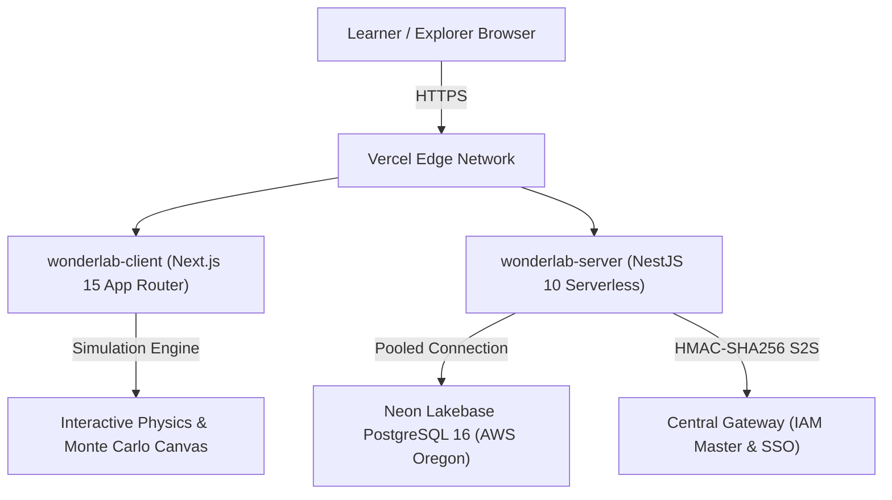

<div align="center">

# Wonderlab

**Interactive digital laboratory exploring science, probability, paradoxes, and logical reasoning — part of the Prism Hub ecosystem.**

[](https://github.com/thanhba0505/wonderlab/actions/workflows/ci.yml)
[](https://github.com/thanhba0505/wonderlab/releases)
[](https://github.com/thanhba0505/wonderlab/releases)
[](https://wonderlab.io.vn)
[](https://wonderlab-server.vercel.app/api/v1)
[](https://wonderlab-server.vercel.app/api/docs)
[](LICENSE)

[🌐 Live Experience](https://wonderlab.io.vn) • [📑 Swagger OpenAPI](https://wonderlab-server.vercel.app/api/docs) • [🧭 Prism Hub Docs](https://github.com/thanhba0505/prism-hub/blob/main/docs/README.md) • [📖 Architecture Guide](https://github.com/thanhba0505/prism-hub/blob/main/docs/wonderlab/architecture.md) • [🚀 Deployment Guide](https://github.com/thanhba0505/prism-hub/blob/main/docs/wonderlab/deployment.md) • [🤖 AGENTS.md](https://github.com/thanhba0505/prism-hub/blob/main/AGENTS.md)

</div>

---

## 📌 Project Overview

**Wonderlab** transforms abstract mathematical laws, quantum physics phenomena, and counterintuitive decision dilemmas into tactile, engaging digital simulations. Rather than memorizing passive textbook formulas, learners manipulate parameters, run high-speed Monte Carlo simulations (up to 10,000+ trials), and witness the convergence between empirical observation and analytical theory.

### Core Capabilities:

- **Interactive Science Lab & Simulations**: Tactile visual benches with immediate physics feedback, real-time parameter tweaking, and instant state transitions.
- **Intuition Gap Challenge**: Assesses pre-conceived cognitive intuition against analytical truth, revealing cognitive heuristics and probability biases.
- **Clean Mathematical Typography**: Scientific equations rendered via calibrated fraction components, mathematical notation, and interactive distribution curves.
- **Academic Discussion & Peer Insights**: Threaded discussion engine for learners and educators to debate strategies and mechanistic explanations.
- **Research Data Export Suite**: One-click data export of experimental trials, runs, and parameters to CSV or JSON formats for statistical analysis.

---

## 🌌 Prism Hub Ecosystem

Wonderlab is a core interactive platform within the **Prism Hub** engineering ecosystem alongside its sister applications:

| Application         | Role & Mission                                        | Standard Local Port | Live Production                                            | Interactive Docs                                                      |
| :------------------ | :---------------------------------------------------- | :-----------------: | :--------------------------------------------------------- | :-------------------------------------------------------------------- |
| **Wonderlab**       | Interactive Science, Probability & Paradox Laboratory |   `4100` / `4101`   | [Live Experience](https://wonderlab.io.vn)                 | [Swagger OpenAPI](https://wonderlab-server.vercel.app/api/docs)       |
| **Central Gateway** | Centralized IAM Master, OAuth2 SSO & Notification Hub |   `5100` / `5101`   | [Control Plane](https://central-gateway-client.vercel.app) | [Swagger OpenAPI](https://central-gateway-server.vercel.app/api/docs) |
| **Git Pulse**       | Developer Intelligence, Dual-Core AI & Activity Radar |   `6100` / `6101`   | [Developer Workspace](https://git-pulse-app.vercel.app)    | [Swagger OpenAPI](https://git-pulse-server.vercel.app/api/docs)       |

> All services share PostgreSQL 16 on local port `5432` during development and connect to serverless Neon Lakebase PostgreSQL in production.

---

## 🏗️ System Architecture



---

## 📦 Monorepo Structure

```text
wonderlab/
├── client/          # Next.js 15 App Router, React 19, Tailwind CSS, Lucide React, Motion
├── server/          # NestJS 10 REST API, Prisma ORM, Swagger OpenAPI, Terminus Health
├── .github/         # Parallel CI/CD workflows, release automation, PR & issue templates
└── scripts/         # Automated release version synchronization and verification scripts
```

> Architectural documentation, ADRs, AI rules (`AGENTS.md`), and shared local Docker PostgreSQL orchestration are centralized in [`thanhba0505/prism-hub`](https://github.com/thanhba0505/prism-hub).

| Workspace    | Technology Stack                              | Local Port | Role & Responsibility                                                             |
| :----------- | :-------------------------------------------- | :--------: | :-------------------------------------------------------------------------------- |
| **`client`** | Next.js 15 App Router, React 19, Tailwind CSS |   `4100`   | Interactive simulation benches, intuition challenges, and public/admin portals.   |
| **`server`** | NestJS 10, Prisma ORM, Neon PostgreSQL        |   `4101`   | REST API (`/api/v1`), simulation telemetry, comment threads, and S2S integration. |

---

## 🚀 Getting Started

### Prerequisites

- **Node.js**: `v24.x` (enforced via `.nvmrc`)
- **Package Manager**: `pnpm` `12.11.2` (`npm i -g pnpm@12.11.2`)
- **PostgreSQL 16**: Running on `127.0.0.1:5432` (managed centrally via Docker Compose in `prism-hub` or native local Postgres)

### 1. Recommended Setup via Prism Hub

```bash
git clone https://github.com/thanhba0505/prism-hub.git
cd prism-hub
make init              # Starts shared PostgreSQL (127.0.0.1:5432), installs deps & syncs DBs
make wonderlab-start   # Starts Wonderlab client (4100) + server (4101)
```

### 2. Standalone Usage (Requires PostgreSQL 16 on `127.0.0.1:5432` with `wonderlab` DB)

```bash
git clone https://github.com/thanhba0505/wonderlab.git
cd wonderlab
cp .env.example .env.local
pnpm install
pnpm dev               # Client on 4100 + Server on 4101
```

Or run individually:

- `pnpm dev:client` — Next.js Client on port `4100`
- `pnpm dev:server` — NestJS Server on port `4101`

### 3. Verification & Testing

```bash
pnpm check          # Full pipeline: Format -> Lint -> Typecheck -> Unit Tests -> E2E -> Build
pnpm test           # Unit test suites (Vitest for client, Jest for server)
pnpm test:e2e       # End-to-end API tests against local database
pnpm lint           # ESLint verification with 0 warnings policy
pnpm format:check   # Prettier code formatting check
```

---

## 📑 Technical Documentation Index

All documentation, ADRs, and AI coding guidelines have moved to the central **[Prism Hub](https://github.com/thanhba0505/prism-hub)** repository:

- [Prism Hub Documentation Hub](https://github.com/thanhba0505/prism-hub/blob/main/docs/README.md)
- [Unified AGENTS.md & Contributing Guide](https://github.com/thanhba0505/prism-hub/blob/main/AGENTS.md)
- [Wonderlab System Architecture](https://github.com/thanhba0505/prism-hub/blob/main/docs/wonderlab/architecture.md)
- [Frontend Engineering & UI Standards](https://github.com/thanhba0505/prism-hub/blob/main/docs/wonderlab/frontend.md)
- [Backend Architecture & S2S Security](https://github.com/thanhba0505/prism-hub/blob/main/docs/wonderlab/backend.md)
- [Deployment & Vercel Serverless Operations](https://github.com/thanhba0505/prism-hub/blob/main/docs/wonderlab/deployment.md)
- [Environment Configuration](https://github.com/thanhba0505/prism-hub/blob/main/docs/wonderlab/environment.md)
- [Architecture Decision Records (ADRs 0001–0019)](https://github.com/thanhba0505/prism-hub/tree/main/docs/wonderlab/decisions)
- [Shared Database & Neon Safety Guide](https://github.com/thanhba0505/prism-hub/blob/main/docs/shared/database.md)

---

## 📄 License

Licensed under the [MIT License](LICENSE) © 2026 **thanhba0505**.
