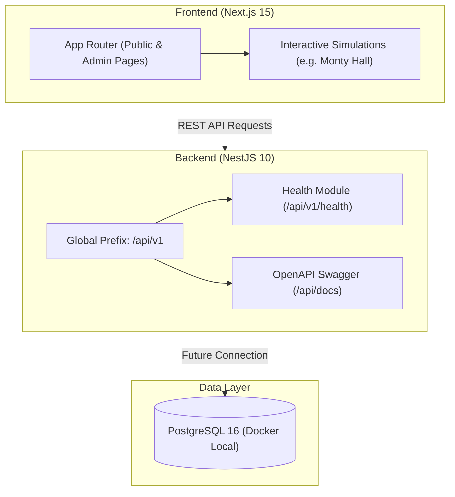

# Architecture Documentation — Wonderlab

## 1. System Overview

Wonderlab is an interactive science and logic exploration platform. Its architecture is structured as a full-stack monorepo designed for performance, modularity, and future extensibility (accommodating hundreds of interactive simulations and games).

---

## 2. Monorepo Organization & Boundaries

| Package / Directory  | Technology                         | Role & Boundary                                                                                                                          |
| -------------------- | ---------------------------------- | ---------------------------------------------------------------------------------------------------------------------------------------- |
| `client/`            | Next.js 15, React 19, Tailwind CSS | High-performance user interface, server components, interactive canvas/SVG simulations. Communicates only via public REST APIs.          |
| `server/`            | NestJS 10, Express, Swagger        | Robust TypeScript API service. Currently provides standardized health endpoints and Swagger documentation. No business domain logic yet. |
| `docs/`              | Markdown                           | Comprehensive system, architectural, and deployment documentation.                                                                       |
| `.agents/skills/`    | Agent Markdown                     | Standard operating procedures and playbooks for AI coding agents.                                                                        |
| `docker-compose.yml` | Docker, PostgreSQL 16 Alpine       | Local database container isolated to loopback network.                                                                                   |

---

## 3. Communication Contracts

1. **Client to Server**:
   - Client resolves backend via `NEXT_PUBLIC_API_BASE_URL` (default: `http://localhost:4101/api/v1`).
   - Server enforces global prefix `/api/v1`.
2. **CORS Policy**:
   - Server allows origins specified in `CORS_ORIGINS` (comma-separated list, default: `http://localhost:4100`).
3. **Data Transfer & Validation**:
   - DTOs validated using `class-validator` and `class-transformer` with `whitelist: true` and `forbidNonWhitelisted: true`.

---

## 4. Architectural Boundaries & Deferred Decisions

- **No Business CRUD in Foundation**: Neither user authentication, puzzle databases, nor scoring engines are implemented in this foundation phase.
- **ORM Selection Intentionally Deferred**: No ORM (Prisma, Drizzle, TypeORM) is coupled to the server at this time. See [ADR 0003](file:///Users/lethanhba/workspace/app/Wonderlab/docs/decisions/0003-deferred-orm-selection.md).
- **Admin Section (`/admin`)**: Currently an unauthenticated UI placeholder to establish layout structure without premature security assumptions.
