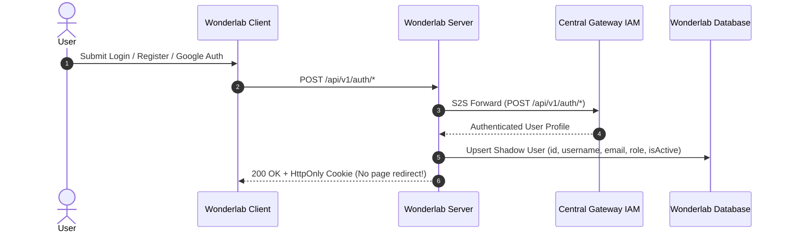

# 0019. Service Connections & Central Gateway IAM User Sync

- **Status**: Accepted
- **Date**: 2026-11-08
- **Author**: Wonderlab Engineering Team

---

## Context & Problem Statement

In earlier iterations, Wonderlab maintained user accounts (including password hashes and local credential verification) independently, while communicating with Central Gateway using static environment variables (`GATEWAY_URL`, `GATEWAY_SECRET_KEY`).

This presented several architectural limitations:

1. **Scattered Identity Management**: User credentials and status were bifurcated between Wonderlab and Central Gateway, preventing seamless single sign-on (SSO) and unified account lifecycle management (e.g., global deactivation, profile updates).
2. **Brittle Configuration via Environment Variables**: Backend services required hardcoded target URLs and secrets in environment configurations. Updating an endpoint, port, or API prefix necessitated redeployment across multiple dependent services.
3. **Rigid Service-to-Service (S2S) Boundaries**: Calling across services lacked a standard registry for timeouts, active status, outbound API keys, and incoming authentication tokens.

---

## Architectural Decision

### 1. Database-Driven Service Discovery (`service_connections`)

We introduced the `service_connections` table across both Central Gateway and Wonderlab to manage all service-to-service connections dynamically:

```prisma
model ServiceConnection {
  id             String    @id @default(uuid())
  slug           String    @unique @db.VarChar(64)
  name           String    @db.VarChar(128)
  domain         String    @db.VarChar(255)
  apiPrefix      String    @default("/api/v1") @map("api_prefix") @db.VarChar(64)
  apiKey         String?   @map("api_key") @db.VarChar(255)
  incomingSecret String?   @map("incoming_secret") @db.VarChar(255)
  isActive       Boolean   @default(true) @map("is_active")
  timeoutMs      Int       @default(10000) @map("timeout_ms")
  metadata       Json?
  createdAt      DateTime  @default(now()) @map("created_at")
  updatedAt      DateTime  @updatedAt @map("updated_at")

  @@map("service_connections")
}
```

- **Separation of Domain and API Prefix**: Domain (e.g., `http://localhost:5101`, `https://central-gateway-server.onrender.com`) is decoupled from API prefix (e.g., `/api/v1`).
- **Asymmetric Key Pairs**: Outbound requests attach `apiKey` via `Authorization: Bearer <apiKey>`, while incoming requests are validated against `incomingSecret`.
- **Soft Deactivation**: Services are toggled via `isActive = true/false` rather than hard deleted, preventing orphaned logs or broken dependencies.
- **CORS Scope Clarification**: S2S communication occurs server-to-server and does not traverse web browsers. CORS is strictly scoped to frontend clients via `CORS_ORIGINS`, avoiding redundant database queries on boot.

### 2. Centralized IAM & Local Shadow User Model

- **Central Gateway as Master IAM**: All user registration, password changes, profile editing, and account status management (`isActive = true/false`) occur directly on Central Gateway.
- **Wonderlab Shadow User**: Wonderlab maintains a shadow user table storing:
  - `id`: Exact UUID issued by Central Gateway.
  - `username`, `email`, `avatarUrl`, `role` (`ADMIN` | `USER`), and `isActive`.
  - Local password hashes, Google IDs, and email verification flags are completely dropped from the database via migration `20261109150000_drop_redundant_auth_columns_and_otp_tokens`, along with the obsolete `otp_tokens` table. Argon2 dependency is eliminated from Wonderlab.
- **Foreign Key Consistency**: Preserves referential integrity for Wonderlab domain data (`simulation_runs`, `comments`, and `simulation_requests`) without distributed joins.
- **Immediate Session Revocation**: If a user is deactivated (`isActive: false`) in Central Gateway, subsequent JWT verification in Wonderlab's `JwtStrategy` immediately blocks access.

### 3. BFF Auth Proxy & On-Demand Shadow User Provisioning

To eliminate complex two-way synchronization and redundant fallbacks, user authentication is managed via an on-demand BFF Auth Proxy pattern:

1. Wonderlab Server forwards authentication requests (`/auth/login`, `/auth/google`, `/auth/register`) directly to Central Gateway via outbound `s2sService.call(...)`.
2. Central Gateway acts as the sole Master IAM authority, validating credentials and returning the authenticated user profile.
3. Wonderlab Server upserts the shadow user record locally by ID to satisfy relational foreign key constraints (`comments`, `simulation_runs`, `simulation_requests`).
4. Wonderlab issues an HttpOnly session cookie, validating JWT tokens offline in memory on every subsequent request without calling Central Gateway.



---

## Consequences

### Positive

- **Zero Environment Duplication**: Wonderlab backend no longer requires `GATEWAY_URL` or `GATEWAY_SECRET_KEY` in environment configurations.
- **Unified Identity**: Users have a single account across the ecosystem, authenticated via OAuth2 PKCE SSO.
- **Robust S2S Security**: Timing-safe bearer authentication with configurable timeouts per connected service.
- **Local Autonomy**: Wonderlab can query and display user profiles and maintain relational data without making synchronous HTTP calls on every read.

### Negative & Mitigations

- **Eventual Consistency on Network Glitches**: If Wonderlab is temporarily unreachable during sync, Central Gateway logs the error in `dispatch_logs`.
- **Read-Only Connections in UI**: Service connections are managed via migrations and seeds; runtime editing is currently frozen to avoid configuration drift.
