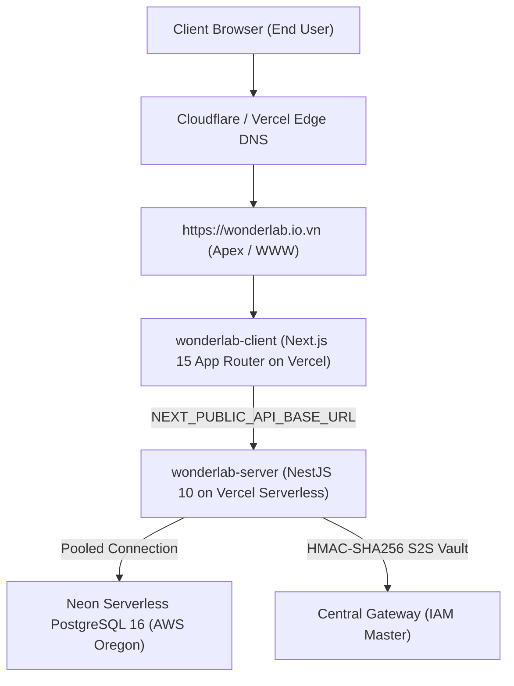
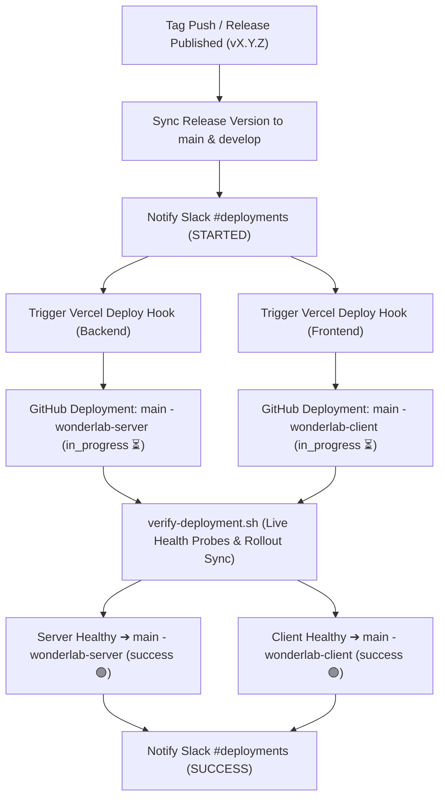

# Wonderlab Deployment Architecture (Vercel & Neon Serverless)

This document provides technical documentation of Wonderlab's deployment infrastructure, DNS routing, and CI/CD automated pipeline.

---

## 1. System Topology & Infrastructure Overview

Wonderlab is deployed on **Vercel** with **Neon Serverless PostgreSQL**:

### Components:

- **Frontend Client (`client/`)**: Next.js 15 App Router deployed to **Vercel** (`wonderlab-client`) with custom domain [wonderlab.io.vn](https://wonderlab.io.vn).
- **Backend Server (`server/`)**: NestJS 10 REST API deployed to **Vercel** (`wonderlab-server`) with Serverless Functions at [wonderlab-server.vercel.app](https://wonderlab-server.vercel.app).
- **Production Database**: **Neon Serverless PostgreSQL 16** (AWS Oregon `us-west-2`) with connection pooling.
- **IAM Master**: Central Gateway providing Single Sign-On and S2S communication.

---

## 2. Infrastructure Specifications

### 1. `wonderlab-client` (Frontend)

- **Platform**: Vercel (`wonderlab-client`)
- **Runtime**: Node.js 24 (`.nvmrc`)
- **Root Directory**: `client`
- **Build Command**: `pnpm build`
- **Health Check Path**: `/health`
- **Custom Domains**:
  - Apex: `https://wonderlab.io.vn` (DNS A record: `76.76.21.21`)
  - Subdomain: `https://www.wonderlab.io.vn` (DNS CNAME record: `cname.vercel-dns.com`)
- **Key Environment Variables**:
  - `NEXT_PUBLIC_APP_NAME`: `Wonderlab`
  - `NEXT_PUBLIC_APP_URL`: `https://wonderlab.io.vn`
  - `NEXT_PUBLIC_API_BASE_URL`: `https://wonderlab-server.vercel.app/api/v1`
  - `NEXT_PUBLIC_GATEWAY_CLIENT_URL`: `https://central-gateway-client.vercel.app`

### 2. `wonderlab-server` (Backend)

- **Platform**: Vercel (`wonderlab-server`)
- **Runtime**: Node.js 24 Serverless (`server/api/index.ts`)
- **Root Directory**: `server`
- **Framework**: NestJS
- **Build Command**: `prisma generate && (if [ -n "$DATABASE_URL" ]; then prisma migrate deploy; fi) && nest build`
- **Health Check Path**: `/api/v1/health`
- **Key Environment Variables**:
  - `NODE_ENV`: `production`
  - `DATABASE_URL`: Connection string to Neon PostgreSQL pooler
  - `JWT_SECRET`: Secret token for local session verification
  - `S2S_ENCRYPTION_KEY`: 256-bit AES-GCM vault key
  - `GATEWAY_URL`: `https://central-gateway-server.vercel.app/api/v1`
  - `CORS_ORIGINS`: `https://wonderlab.io.vn,https://wonderlab-client.vercel.app`

---

## 3. DNS Configuration for Custom Domain (`wonderlab.io.vn`)

| Record Type | Host / Name | Target / Value         | Description                       |
| :---------- | :---------- | :--------------------- | :-------------------------------- |
| **A**       | `@`         | `76.76.21.21`          | Vercel Anycast IP for apex domain |
| **CNAME**   | `www`       | `cname.vercel-dns.com` | CNAME routing for `www` subdomain |

Vercel automatically provisions and renews Let's Encrypt TLS certificates once DNS propagates.

---

## 4. Automated CD Pipeline & Deployment Tracking

Deployments are triggered on published releases (`git tag vX.Y.Z`) via `.github/workflows/deploy.yml`:

1. **Deployment Initiation**: Triggered via Vercel Deploy Hooks using `VERCEL_SERVER_DEPLOY_HOOK` and `VERCEL_CLIENT_DEPLOY_HOOK`.
2. **Real-time Observability**: Immediately registers GitHub Deployments for `main - wonderlab-server` and `main - wonderlab-client` with `state: in_progress`.
3. **Health Verification**: Runs `scripts/verify-deployment.sh` to poll live health endpoints (`https://wonderlab.io.vn/health` and `https://wonderlab-server.vercel.app/api/v1/health`).
4. **Resolution**: As each service becomes healthy, its corresponding GitHub Deployment transitions to `success` 🟢.
5. **Slack Alerts**: Posts rich notifications to `#deployments` at deployment start and resolution.

---

## 5. Production Verification Checklist

- [ ] Confirm `https://wonderlab.io.vn` renders cleanly via Vercel with HTTP 200 and valid SSL.
- [ ] Confirm `https://wonderlab.io.vn/health` returns `{"status":"ok","service":"wonderlab-client"}`.
- [ ] Confirm `https://wonderlab-server.vercel.app/api/v1/health` returns `{"status":"ok","database":"connected"}`.
- [ ] Confirm S2S authentication succeeds with Central Gateway.
- [ ] Confirm live GitHub Deployments report `success` 🟢.
