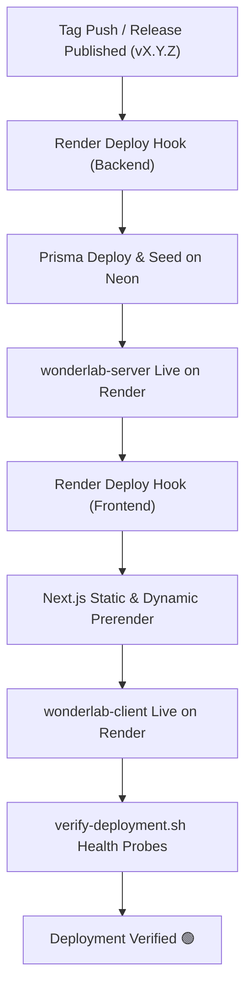

# Deployment Guide — Wonderlab

## 1. Overview & Cloud Architecture

Wonderlab is deployed across a decoupled multi-cloud architecture maximizing reliability, performance, and resource isolation while staying within generous free-tier quotas:

- **Frontend Client (`client/`)**: Next.js 15 App Router deployed to a dedicated **Render Frontend Workspace** (`Wonderlab Frontend`, `render.client.yaml`). Custom domain `https://wonderlab.io.vn` with automated SSL and edge routing.
- **Backend Server (`server/`)**: NestJS 10 REST API deployed to a dedicated **Render Backend Workspace** (`Wonderlab Backend`, `render.server.yaml`) at `https://wonderlab-server.onrender.com`.
- **Production Database**: **Neon Serverless PostgreSQL** (AWS Oregon `us-west-2`). Zero-maintenance serverless pooling, automatic branchable backups, and unlimited lifespan (replacing Render's 30-day ephemeral database).

### Architectural Benefits:

1. **Isolated Compute Quotas**: Splitting Frontend and Backend into separate Render workspaces grants each service an independent 750 free instance hours per month, eliminating CPU/RAM contention.
2. **Persistent Cloud Database**: Neon PostgreSQL runs outside Render container lifetimes, ensuring zero data loss on service restarts or scale-downs.
3. **Clean GitHub Deployments**: Unified deployment environments on GitHub (`main - wonderlab-client` and `main - wonderlab-server`) without fragmented Preview/Production clutter.

---

## 2. Infrastructure Specifications

### 1. `wonderlab-client` (Frontend Workspace — `render.client.yaml`)

- **Workspace**: `Wonderlab Frontend` (`tea-dbncn7bm8hqs73brgk10`)
- **Service ID**: `srv-dbncpvbrjlhs738edp5g` (`wonderlab-client`)
- **Render Hostname**: `wonderlab-client-iwl8.onrender.com`
- **Runtime**: Node.js 24 (`.nvmrc`)
- **Plan**: `free` (750 hours/month isolated quota)
- **Region**: `oregon` (co-located with Neon database)
- **Auto Deploy**: `false` (orchestrated via release workflow)
- **Build Command**: `pnpm install --frozen-lockfile && pnpm --filter wonderlab-client build`
- **Start Command**: `pnpm --filter wonderlab-client start` (executes `next start -p ${PORT:-4100}`, dynamically binding to Render's injected `PORT=10000`)
- **Health Check Path**: `/health`
- **Custom Domains**:
  - Apex: `https://wonderlab.io.vn` (DNS A record: `216.24.57.1`)
  - Subdomain: `https://www.wonderlab.io.vn` (DNS CNAME record: `wonderlab-client-iwl8.onrender.com`)
- **Environment Variables**:
  - `NODE_ENV`: `production`
  - `PORT`: `10000`
  - `NEXT_PUBLIC_APP_NAME`: `Wonderlab`
  - `NEXT_PUBLIC_APP_URL`: `https://wonderlab.io.vn`
  - `NEXT_PUBLIC_API_BASE_URL`: `https://wonderlab-server.onrender.com/api/v1`

### 2. `wonderlab-server` (Backend Workspace — `render.server.yaml`)

- **Workspace**: `Wonderlab Backend` (`tea-dbe7vkks728c73bb2mf0`)
- **Service ID**: `srv-dbe87e7b9u1s738pj47g` (`wonderlab-server`)
- **Render Hostname**: `https://wonderlab-server.onrender.com`
- **Runtime**: Node.js 24 (`.nvmrc`)
- **Plan**: `free` (750 hours/month isolated quota)
- **Region**: `oregon`
- **Auto Deploy**: `false` (orchestrated via release workflow)
- **Build Command**: `pnpm install --frozen-lockfile && pnpm --filter wonderlab-server db:generate && pnpm --filter wonderlab-server build`
- **Start Command**: `pnpm --filter wonderlab-server prisma migrate deploy && pnpm --filter wonderlab-server db:seed && pnpm --filter wonderlab-server start:prod`
- **Health Check Path**: `/api/v1/health`
- **Environment Variables**:
  - `NODE_ENV`: `production`
  - `SERVER_PORT`: `10000`
  - `DATABASE_URL`: Neon pooled connection string (`postgresql://...ep-curly-math-ar8nnbms-pooler.c-4.us-west-2.aws.neon.tech/neondb?sslmode=require&channel_binding=require`)
  - `JWT_SECRET`: Secure cryptographic token
  - `CORS_ORIGINS`: `https://wonderlab.io.vn`

---

## 3. DNS Configuration for Custom Domain (`wonderlab.io.vn`)

To route traffic to Render Frontend with automatic SSL generation:

| Record Type | Host / Name | Target / Value                       | Description                       |
| :---------- | :---------- | :----------------------------------- | :-------------------------------- |
| **A**       | `@`         | `216.24.57.1`                        | Render Anycast IP for apex domain |
| **CNAME**   | `www`       | `wonderlab-client-iwl8.onrender.com` | CNAME routing for `www` subdomain |

Render's Cloudflare-backed proxy automatically provisions and renews Let's Encrypt TLS certificates once DNS propagates.

---

## 4. Automated CD Pipeline & Deployment Tracking

Deployments are triggered on published releases (`git tag vX.Y.Z`) via `.github/workflows/deploy.yml`:



1. **Backend Rollout**: Triggers `RENDER_SERVER_DEPLOY_HOOK`, runs migrations against Neon, and launches NestJS.
2. **Frontend Rollout**: Triggers `RENDER_CLIENT_DEPLOY_HOOK`, builds Next.js assets with optimized standalone output.
3. **Health Verification**: Runs `scripts/verify-deployment.sh` to poll live health endpoints (`https://wonderlab.io.vn/health` and `https://wonderlab-server.onrender.com/api/v1/health`).
4. **GitHub Deployments Integration**:
   - 🟢 `main - wonderlab-client`
   - 🟢 `main - wonderlab-server`

---

## 5. Render CLI & API Operations

The repository utilizes Render CLI (`render`) and REST API for continuous verification.

### Check Service Status

```bash
render services list
```

### Inspect Recent Deploys via API

```bash
API_KEY=$(grep 'key:' ~/.render/cli.yaml | awk '{print $2}')
curl -s -H "Authorization: Bearer $API_KEY" \
  "https://api.render.com/v1/services/srv-dbncpvbrjlhs738edp5g/deploys?limit=2" | jq .
```

### Trigger Fresh Deploy with Cache Clear

```bash
curl -s -X POST -H "Authorization: Bearer $API_KEY" \
  -H "Content-Type: application/json" \
  -d '{"clearCache": "clear"}' \
  "https://api.render.com/v1/services/srv-dbncpvbrjlhs738edp5g/deploys" | jq .
```

---

## 6. Production Verification Checklist

- [ ] Confirm `https://wonderlab.io.vn` renders cleanly via Render with HTTP 200 and valid SSL.
- [ ] Confirm `https://wonderlab.io.vn/health` returns `{"status":"ok","service":"wonderlab-client"}`.
- [ ] Confirm `https://wonderlab-server.onrender.com/api/v1/health` returns `{"status":"ok","database":"connected"}`.
- [ ] Confirm `GET /api/v1/simulations/stats` reads live statistics from Neon PostgreSQL.
- [ ] Verify CORS preflight succeeds from `https://wonderlab.io.vn` to `wonderlab-server`.
